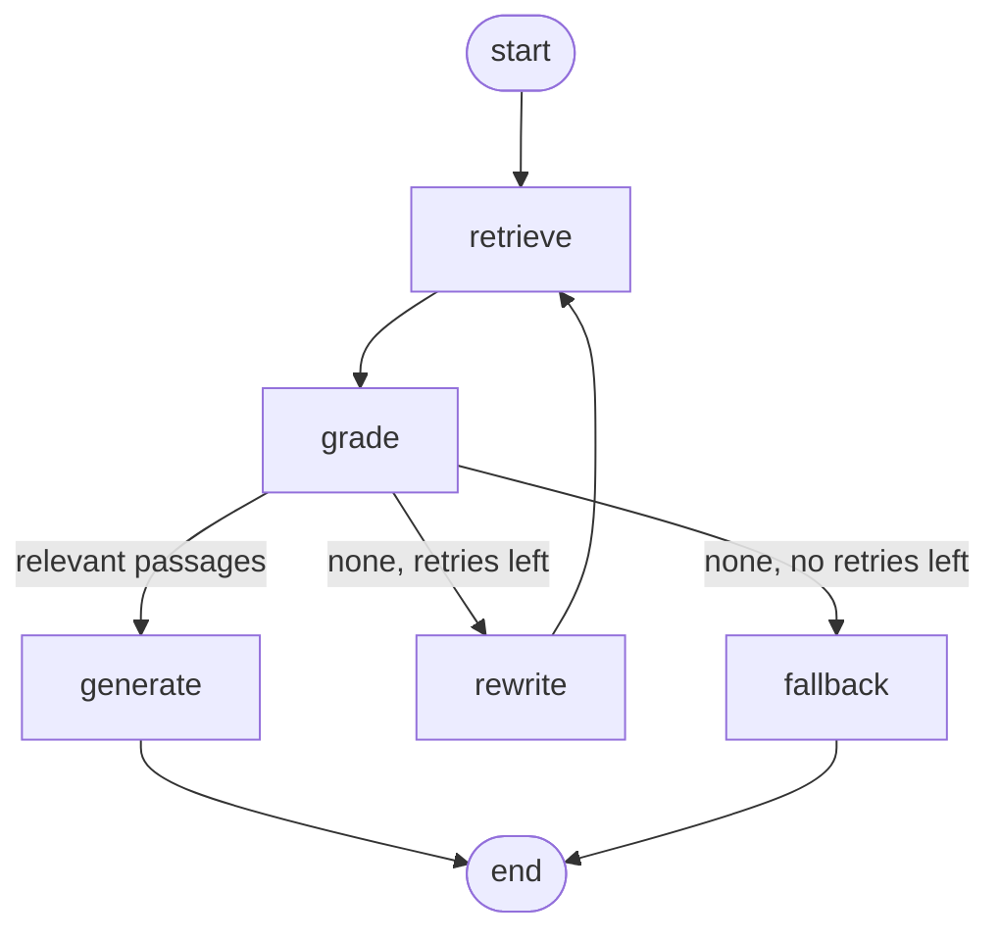

# LangGraph RAG Agent

[](https://github.com/Ilabuonf/langgraph-rag-agent/actions/workflows/ci.yml)


A **self-correcting RAG agent** built with [LangGraph](https://github.com/langchain-ai/langgraph). It answers questions about your own documents (Markdown, text or PDF), **cites its sources**, and **says "I don't know"** instead of making things up when the answer is not in the documents.

It runs with **OpenAI** or **Azure OpenAI**, and also works fully **offline** (no API key) so you can try it in 30 seconds and the tests run in CI for free.

```text
$ ragagent ask "When is business class allowed for flights?"

Economy class is the default for flights; business class is allowed only for flights longer than six hours. [1]

Sources:
  [1] expenses.md#0

$ ragagent ask "What is the parental leave entitlement?"

I couldn't find the answer in the provided documents.
```

## How it works

The agent is a LangGraph state machine rather than a single prompt, so every step can be inspected, tested and improved on its own:



| Node | What it does |
| --- | --- |
| `retrieve` | Embeds the query and returns the top-k chunks by cosine similarity. |
| `grade` | The LLM judges each chunk as relevant or not, using **structured output** (a Pydantic `Grade` schema). Irrelevant chunks never reach the prompt. |
| `rewrite` | If nothing relevant was found, the LLM rewrites the question into a better search query and the agent retrieves again (self-correction, max 1 retry by default). |
| `generate` | Answers **only from the graded passages** and returns a Pydantic `Answer` with the numbers of the passages it used. Invalid citation numbers are discarded. |
| `fallback` | Returns an explicit "not found" answer instead of hallucinating. |

In offline mode the same graph runs with transparent heuristics: hashing embeddings, keyword-overlap grading and extractive answers.

## Quickstart

```bash
git clone https://github.com/Ilabuonf/langgraph-rag-agent.git
cd langgraph-rag-agent
python -m venv .venv && source .venv/bin/activate   # Windows: .venv\Scripts\activate
pip install -e ".[dev]"

ragagent ingest data/docs          # index the sample documents
ragagent ask "How long must passwords be?"
ragagent chat                      # interactive mode
```

No API key is needed: the default provider is `fake` (offline).

### Use OpenAI or Azure OpenAI

```bash
cp .env.example .env               # then fill in your keys
```

```dotenv
# OpenAI
LLM_PROVIDER=openai
OPENAI_API_KEY=sk-...

# or Azure OpenAI
LLM_PROVIDER=azure
AZURE_OPENAI_API_KEY=...
AZURE_OPENAI_ENDPOINT=https://<resource>.openai.azure.com/
AZURE_OPENAI_CHAT_DEPLOYMENT=gpt-4o-mini
AZURE_OPENAI_EMBEDDING_DEPLOYMENT=text-embedding-3-small
```

Re-run `ragagent ingest` after switching provider: the index stores which embedding model built it and refuses to be queried with a different one.

### Your own documents

```bash
ragagent ingest path/to/your/folder    # .md, .txt and .pdf, searched recursively
ragagent chat
```

## Evaluation

RAG quality is measured, not assumed. `data/eval/questions.jsonl` holds 17 labelled questions, including 3 that **cannot** be answered from the documents:

```bash
ragagent eval data/eval/questions.jsonl
```

Offline baseline (provider `fake`):

| Metric | Value |
| --- | --- |
| Retrieval hit rate@4 | 100% |
| Retrieval MRR | 0.96 |
| Citation accuracy (answer cites the right document) | 100% |
| Refusal accuracy (unanswerable questions refused) | 100% |

The same thresholds run as a regression test in CI, so a change that makes retrieval or grounding worse fails the build.

## Project structure

```text
src/ragagent/
├── config.py        # settings from environment variables / .env
├── ingest.py        # loading (.md/.txt/.pdf) and overlap-aware chunking
├── vectorstore.py   # NumPy cosine-similarity store, persisted to disk
├── providers.py     # OpenAI, Azure OpenAI and offline providers
├── graph.py         # the LangGraph agent
├── evaluation.py    # hit rate, MRR, citation and refusal accuracy
└── cli.py           # ingest | ask | chat | eval | graph
tests/               # 22 pytest tests, including a stubbed-LLM path
data/docs/           # sample documents (a fictional company handbook)
data/eval/           # labelled evaluation questions
```

## Design decisions

- **Graph instead of one prompt.** Grading, rewriting and refusing are explicit nodes with explicit edges, which makes failure modes visible and testable.
- **Structured outputs everywhere the code makes a decision.** The router reads a boolean and the answer carries citation numbers, so no free text is parsed.
- **Refusing is a feature.** A wrong but confident answer is worse than "not found"; refusal accuracy is a tracked metric.
- **No vector database, on purpose.** For a few thousand chunks a NumPy matrix is fast and keeps retrieval easy to read. The `VectorStore` interface can be swapped for FAISS, pgvector or Azure AI Search.
- **Offline mode.** Tests and CI need no secrets and cost nothing, and anyone can try the project immediately.

## Development

```bash
make test       # pytest
make lint       # ruff check + format check
make demo       # ingest the sample docs, ask a question, run the evaluation
```

Or with Docker:

```bash
docker build -t ragagent .
docker run --rm ragagent ask "How many days of paid holiday do employees have?"
```

## Roadmap

- Hybrid retrieval (BM25 + embeddings) and a re-ranker
- LLM-as-judge faithfulness metric for generated answers
- Conversation memory with LangGraph checkpoints
- A small FastAPI endpoint and web UI

## Author

**Ilaria Buonfrate** · Data & AI Engineer · Madrid
[LinkedIn](https://www.linkedin.com/in/ilaria-buonfrate-3277a9177/) · [GitHub](https://github.com/Ilabuonf)

Licensed under the MIT License.
